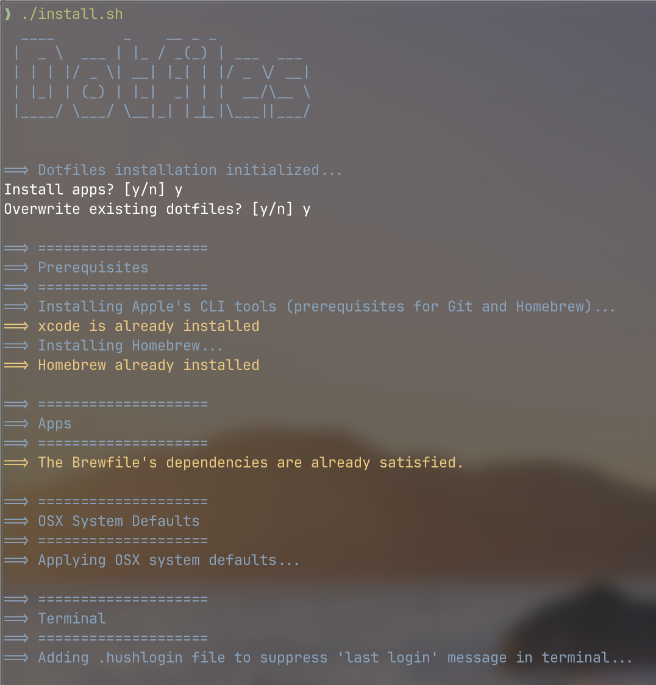
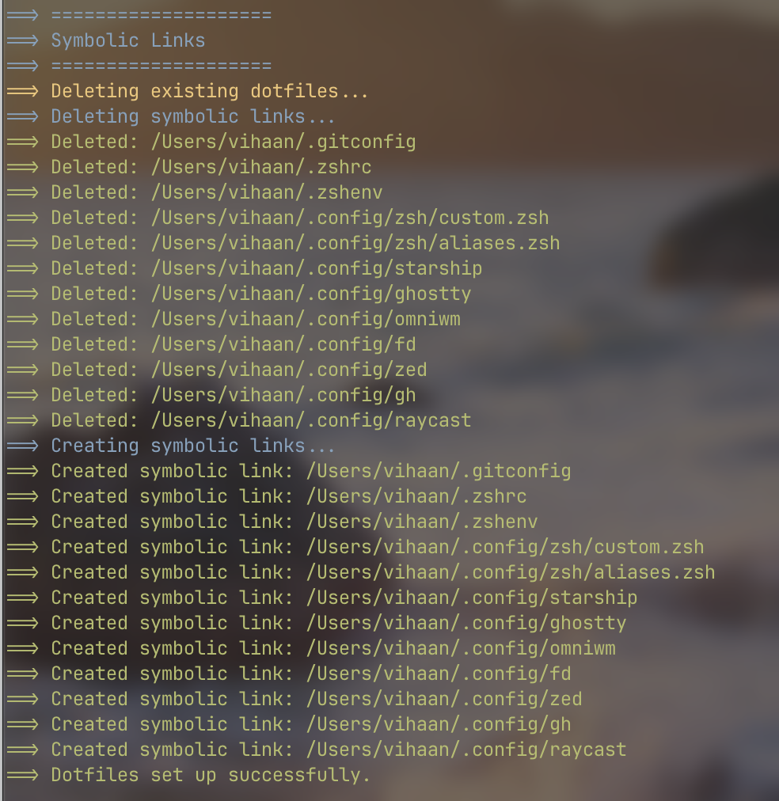

# macOS Dotfiles

An automated, modular, and cleanly structured dotfiles configuration for macOS. This repository manages system preferences, application installations via Homebrew, and symlinks for unified environment configuration across machines.

## Features

*   **Automated Setup:** A single `install.sh` script handles the entire bootstrapping process.
*   **Package Management:** Fully utilizes Homebrew and a `Brewfile` to install core utilities, Casks, and fonts.
*   **Modular Architecture:** Configurations are broken down into logical components (symlinks, Homebrew, macOS defaults, prerequisites).
*   **Safe Symlinking:** Dynamically creates required directories and safely symlinks configurations for Zsh, Starship, Ghostty, OmniWM, Zed, and more.

## Prerequisites

Ensure you are running this on a macOS environment. The installation script will automatically handle the installation of the following prerequisites if they are missing:
*   Apple Xcode Command Line Tools
*   Homebrew

## Installation

1.  **Clone the repository:**
    ```bash
    git clone https://github.com/vihaanraina6/dotfiles ~/.dotfiles
    cd ~/.dotfiles
    ```

2.  **Make the script executable:**
    ```bash
    chmod +x install.sh
    ```

3.  **Run the installation:**
    ```bash
    ./install.sh
    ```

4.  **Follow the prompts:** 
    The script will interactively ask if you want to install applications (via Homebrew) and whether you want to overwrite existing dotfiles before symlinking.




## Repository Structure

*   `install.sh`: The master execution script that runs all sub-scripts in the correct order.
*   `symlinks.conf`: A colon-separated configuration file mapping the source files in this repository to their target destinations on your local machine.
*   `scripts/`: Contains the modular bash scripts that power the setup:
    *   `prerequisites.sh`: Installs Xcode CLI tools and Homebrew.
    *   `brew-install.sh`: Runs `brew bundle install` using the provided `Brewfile`.
    *   `osx-defaults.sh`: Applies custom macOS system defaults (Trackpad, Finder, Dock, etc.).
    *   `symlinks.sh`: Reads `symlinks.conf` to safely map configurations to your system.
    *   `utils.sh`: Provides global color and logging utilities (info, success, error, warning).
*   `homebrew/`: Contains the `Brewfile` defining all taps, brews, and casks.
*   `zsh/`: Contains modular Zsh configurations (`.zshrc`, `.zshenv`, `aliases.zsh`, `custom.zsh`).
*   Config Directories: Contains specific settings for `ghostty`, `omniwm`, `starship`, `zed`, `gh`, `fd`, and `git`.

## Post-Installation

*   **Zsh:** Restart your terminal or run `source ~/.zshrc` to load the new environment, aliases, and syntax highlighting.
*   **macOS Defaults:** Some macOS defaults (like Dock and Finder settings) are applied immediately by restarting those processes, but a full system reboot is recommended to ensure all system-level preferences take effect.
